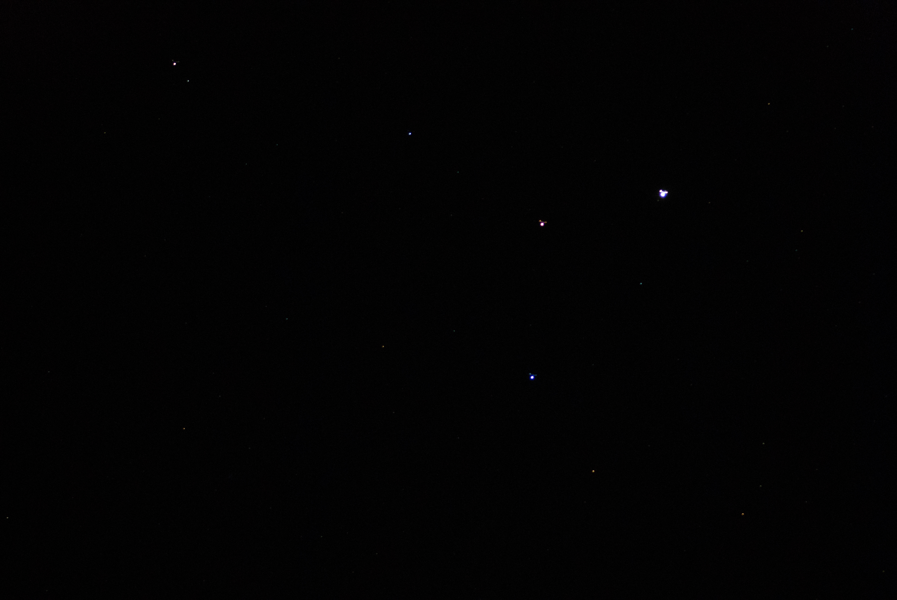

# Observational Astronomy & Astrophotography

An independent research project exploring observational astronomy, astrophotography, astrometric calibration and computational analysis of astronomical data.

This repository documents primary observational data collected in Northern Ireland, alongside scientific methodologies, astronomical imaging, celestial object identification and reproducible data analysis.

## Research interests

- Observational astronomy and astrophotography
- Planetary conjunctions and celestial mechanics
- Stellar identification and classification
- Astrometric calibration and plate solving
- Deep-sky observations
- Computational astronomy
- Astronomical image processing and data visualisation

## Observation archive

| ID | Date | Observation | Constellation |
|---|---|---|---|
| 001 | 2026-11-21 | [Mars, Jupiter and Regulus](observations/2026-11-21-leo-conjunction/observation.md) | Leo |

## Featured observation

### Mars, Jupiter and Regulus — November 2026

Photographed from Belfast on 21 November 2026 at approximately 04:00 GMT.

Astrometric plate solving successfully calibrated the image, extracting 2,184 potential astronomical sources and enabling the identification of prominent stars, including Regulus and Algieba.

[View the full observation report and scientific datasets](observations/2026-11-21-leo-conjunction/observation.md)

## Research methodology

1. Primary observational data collection
2. Astronomical photography and image processing
3. Astrometric plate solving
4. Astronomical catalogue matching
5. Celestial object identification
6. Scientific interpretation and documentation
7. Computational analysis and validation

## Tools and technologies

### Currently used

- Digital astronomical imaging
- Astrometry.net
- FITS astronomical data format
- World Coordinate System (WCS)
- Git and GitHub
- Markdown

### Planned computational tools

- Python
- Astropy
- NumPy
- Matplotlib
- Astroquery
- Jupyter Notebook

## Data and reproducibility

Individual observations include original photographs, annotated imagery, astrometric calibration files, source extraction data and methodological documentation.

Catalogue annotations are distinguished from confirmed photographic detections. Preliminary findings are subject to further analysis and verification.

## Future research

- Identification and verification of planetary satellites
- Stellar photometry
- Celestial coordinate transformations
- Planetary motion and orbital tracking
- Longitudinal astronomical observations
- Automated astronomical image analysis
- Deep-sky imaging and source detection

## Author

Erin McRandal, MSc Computing

Independent interdisciplinary researcher with interests in astronomy, environmental science, computational research and scientific imaging.
