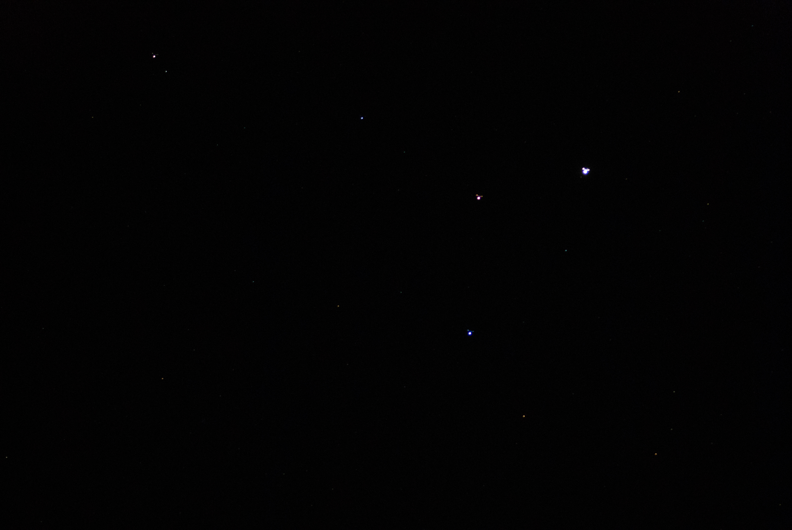
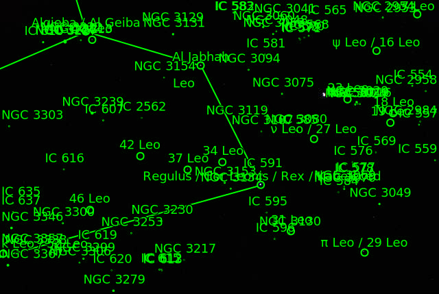
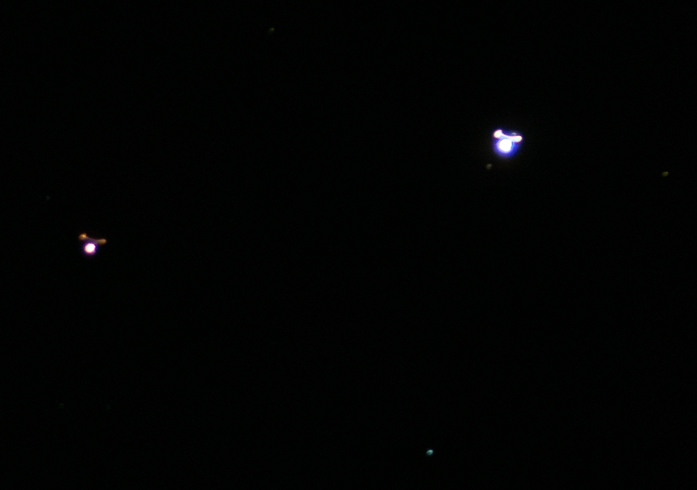
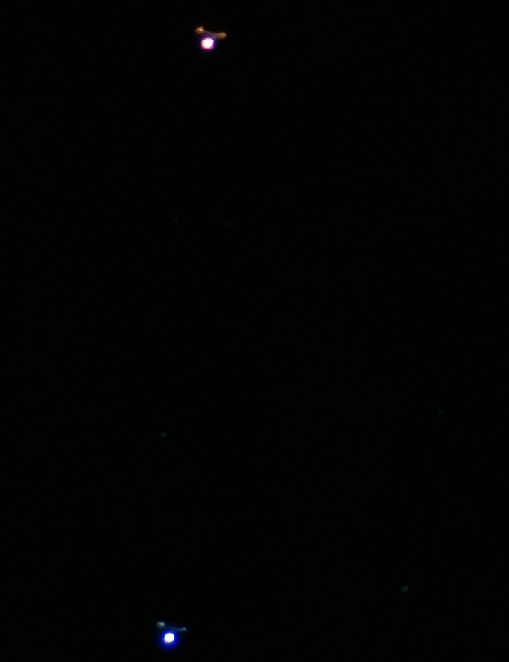
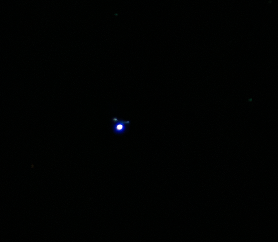

## Photographic documentation

### Original observation

Mars, Jupiter and Regulus observed in the constellation Leo from Belfast on 21 November 2026.

### Astrometric identification

Annotated star field generated using Astrometry.net, identifying catalogue objects and constellation boundaries.

### Mars and Jupiter

Magnified view of Mars and Jupiter. Secondary luminous features require further analysis to distinguish imaging artefacts from astronomical sources.

### Mars and Regulus

Comparison of the reddish appearance of Mars and the blue-white stellar radiation of Regulus.

### Regulus (Alpha Leonis)

Magnified photographic observation of Regulus.

## Scientific datasets

The following files are provided to support reproducibility and further computational analysis.

| Dataset | Description |
|---|---|
| [WCS calibration](data/wcs.fits) | Celestial coordinate calibration |
| [Source extraction](data/axy.fits) | Extracted image sources |
| [Catalogue correspondences](data/corr.fits) | Matched astronomical sources |
| [Reference coordinates](data/rdls.fits) | Reference catalogue positions |
| [Image RA/Dec](data/image-radec.fits) | Celestial coordinates of image sources |
| [Calibrated FITS image](data/new-image.fits.zip) | Calibrated image with lossless compression |
| [Astrometric results](data/astrometry-results.txt) | Plate-solving results and processing metadata |

The calibrated FITS image must be extracted from its ZIP archive before analysis.

